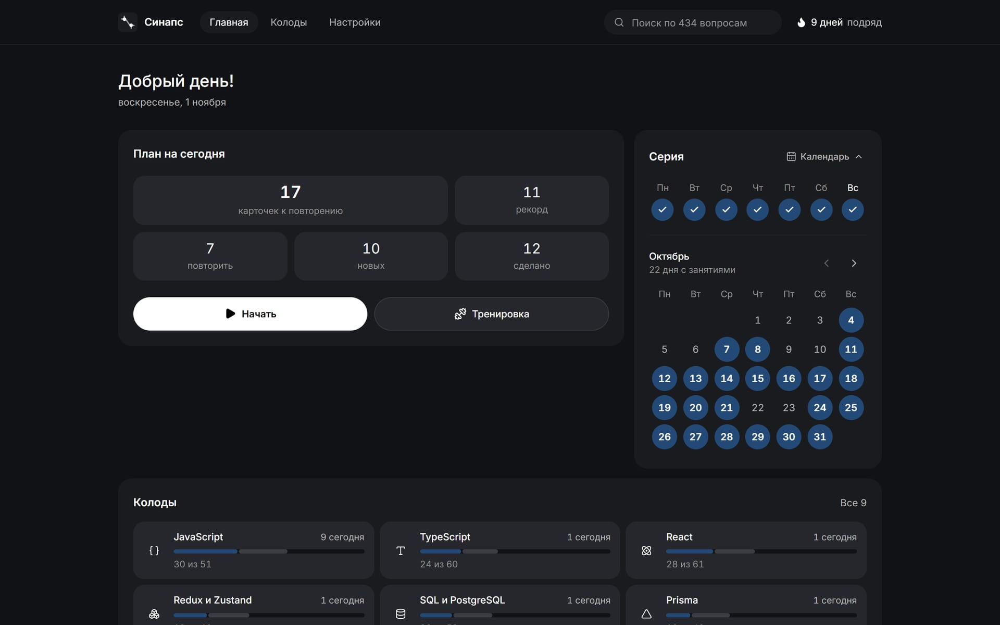
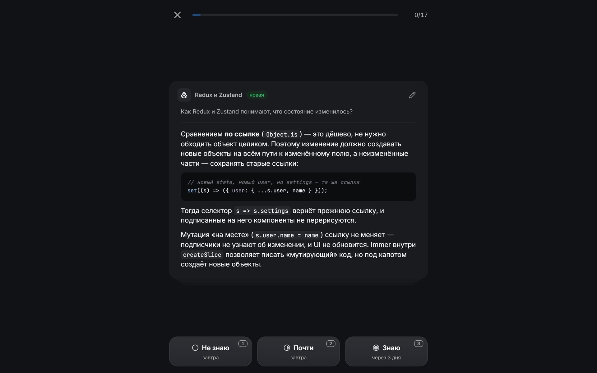
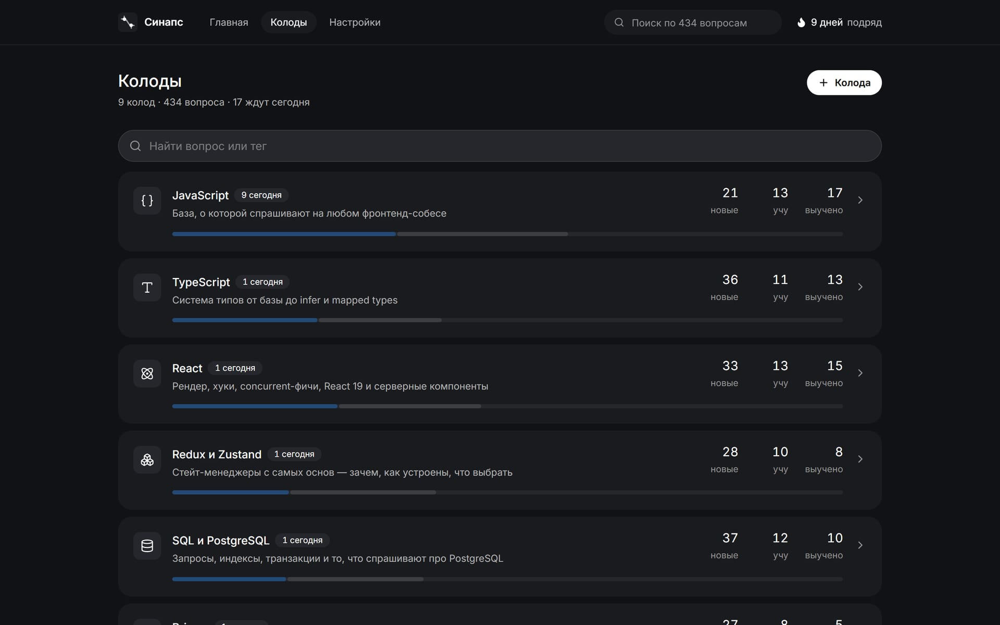
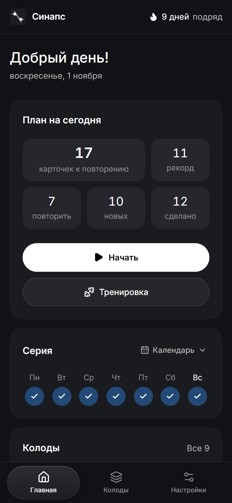
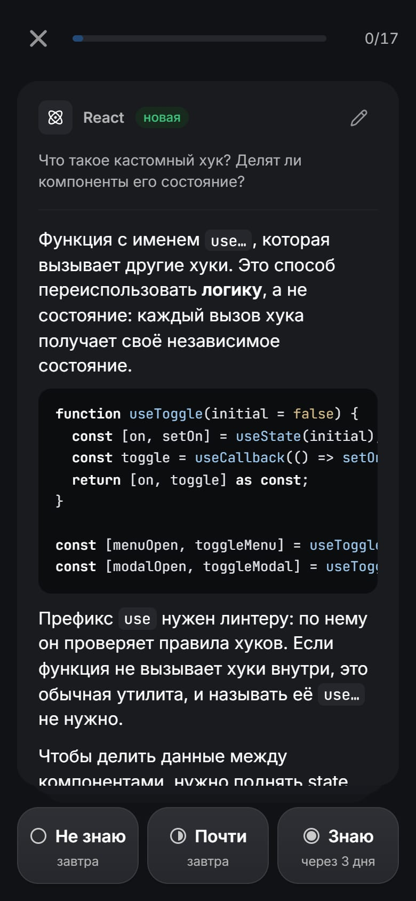
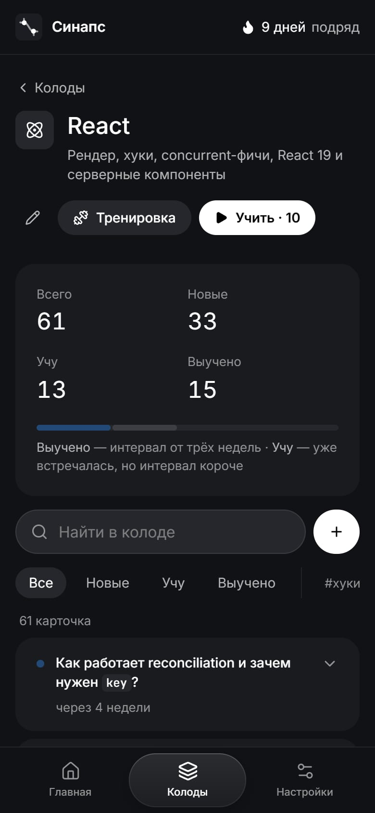

# Синапс — тренажёр к собеседованиям

Мобильное веб-приложение для подготовки к собеседованиям фронтенд-разработчика. Вопросы в формате карточек, интервальные повторения по алгоритму SM-2 и работа без интернета.

**[Открыть демо →](https://chursinov-nikita.github.io/interview-trainer/)** · устанавливается на телефон как обычное приложение



## О проекте

Перед собеседованием важно не прочитать материал один раз, а помнить его в нужный день. «Синапс» каждый день показывает только те вопросы, которые пора повторить. Ответил легко — карточка вернётся через несколько дней. Забыл — завтра.

- **434 вопроса в 9 темах:** JavaScript, TypeScript, React, Redux и Zustand, SQL и PostgreSQL, Prisma, Next.js, CSS и задачи «что выведет код?».
- **Ответы проверены на практике.** Каждый пример кода прогонялся во время разработки: JavaScript в Node.js, типы в компиляторе TypeScript, SQL в PostgreSQL, CSS в браузере. Ответы про Next.js и Prisma сверены с документацией актуальных версий.
- **Работает без интернета и без регистрации.** Данные хранятся на устройстве, прогресс можно перенести файлом.
- **Ставится на телефон** как PWA: иконка на главном экране, полноэкранный режим, офлайн.

## Возможности

- Ежедневная сессия: вопрос → ответ → оценка «не знаю / почти / знаю». Забытая карточка возвращается в этой же сессии.
- Управление с клавиатуры (пробел, 1–3, стрелки) и свайпами на телефоне.
- На главном экране: план на сегодня, серия дней с календарём занятий, прогресс по колодам и самые трудные вопросы.
- Свободная тренировка без влияния на расписание — перед конкретным собеседованием.
- Свои колоды и карточки с Markdown и подсветкой кода, поиск по всем вопросам.
- Экспорт и импорт данных в JSON, светлая и тёмная тема.

## Скриншоты





<p>
  
  
  
</p>

## Технологии

| Область | Что используется |
| --- | --- |
| Язык и фреймворк | TypeScript (strict), React 19, Next.js 16 (App Router, статический экспорт) |
| Состояние и данные | Zustand с `persist` поверх IndexedDB (`idb-keyval`) |
| Стили | Tailwind CSS 4, дизайн-токены на CSS-переменных, светлая и тёмная тема |
| Контент | Markdown → типизированный модуль на этапе сборки, `react-markdown`, `highlight.js` |
| PWA | Web App Manifest, собственный Service Worker с офлайн-кэшем |
| Инфраструктура | GitHub Actions → GitHub Pages, ESLint, React Compiler |

## Технические решения

**Интервальные повторения.** Реализован SM-2 в варианте Anki: у каждой карточки есть интервал и коэффициент лёгкости. Три оценки по-разному меняют оба параметра. Перед ответом кнопки показывают, через сколько дней карточка вернётся. Дневная очередь собирает просроченные карточки и новые с лимитом в день, новые чередуются между темами.

**Local-first без бэкенда.** Всё состояние живёт в Zustand и сохраняется в IndexedDB: лимит сотни мегабайт, асинхронная запись. Пока база восстанавливается, интерфейс показывает плоские заглушки на месте будущих блоков, поэтому при гидратации нет расхождений с серверной разметкой. Стартовые карточки обновляются у пользователя автоматически, а отредактированные и удалённые им остаются нетронутыми.

**Офлайн и установка.** Service Worker заранее кэширует все экраны: страницы обновляются по стратегии network-first, статика — cache-first. У каждой сборки своя версия кэша, поэтому обновление подхватывается при следующем запуске, а старые файлы удаляются.

**Безопасный импорт.** Файл импорта — внешние данные, поэтому каждое поле проверяется: защита от загрязнения прототипа (`__proto__`), проверка дат и числовых диапазонов, лимиты на размер и длину текста. Markdown рендерится без сырого HTML, опасные ссылки (`javascript:`, `data:`) отбрасываются.

**Контент как код.** Вопросы пишутся в обычных Markdown-файлах (`content/`). Скрипт сборки проверяет их формат и уникальность id и генерирует типизированный модуль — опечатка в цвете или иконке колоды ломает сборку, а не приложение.

**Современный React.** `useSyncExternalStore` для темы, звука и даты, `useEffectEvent` для горячих клавиш, `useDeferredValue` для поиска по сотням карточек без задержки ввода, View Transitions для переходов между экранами, React Compiler вместо ручной мемоизации.

**Интерфейс.** Дизайн-система на токенах: слои различаются только яркостью, единственный акцентный цвет используется для данных. Мобильная раскладка — отдельная композиция, а не сжатая десктопная. Учтены доступность и `prefers-reduced-motion`.

## Структура

```
app/            экраны (App Router) и компоненты
  lib/          логика: SM-2, очередь повторений, хранилище, импорт
content/        вопросы в Markdown — по файлу на тему
scripts/        сборка контента, иконок и версии Service Worker
public/         Service Worker, иконки, логотип
```

## Запуск

```bash
npm install
npm run dev     # http://localhost:3000
npm run build   # статическая сборка в out/
```

Каждый push в `main` автоматически собирает проект и публикует его на GitHub Pages.

## Планы

- Режим мок-собеседования: случайные вопросы с таймером и разбором ответа.
- Генерация карточек из статьи или документации по ссылке.
- Публичные колоды, которыми можно делиться.

## Автор

Никита Чурсинов — [GitHub](https://github.com/Chursinov-Nikita)
